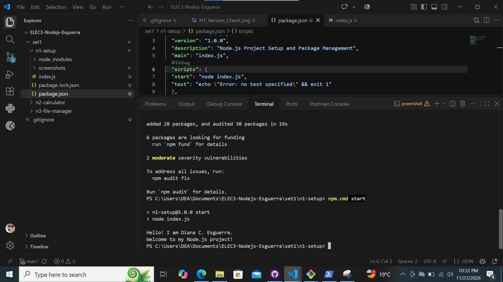
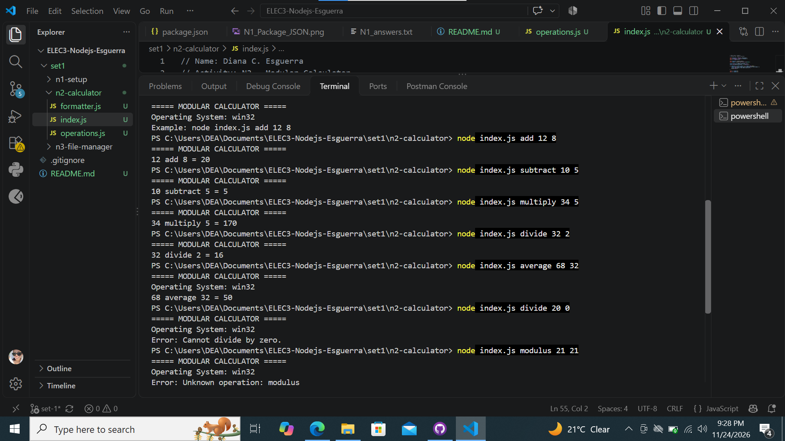
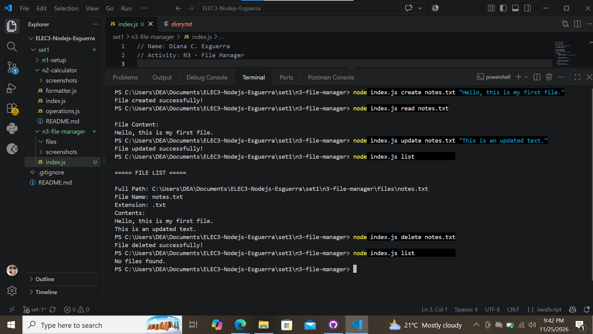

# ELEC3 - Node.js Activities

**Student Name:** Diana C. Esguerra  
**Section:** IV - BSIT - B  
**Course:** LN01_ELEC3 - Elective 3 (Special Topics on Web and Mobile 1)

## Set 1 Activities

| Activity | Description | Folder | Run Command |
|---|---|---|---|
| N1 - Project Setup | Sets up a Node.js project using npm and dependencies. | [N1](set1/n1-setup/) | `npm start` |
| N2 - Modular Calculator | Uses custom and built-in modules to perform calculations. | [N2](set1/n2-calculator/) | `node set1/n2-calculator/index.js add 12 8` |
| N3 - File Manager | Uses fs and path modules to create, read, update, delete, and list text files. | [N3](set1/n3-file-manager/) | `node set1/n3-file-manager/index.js list` |

## Set 1 Screenshots

### N1 - Project Setup

### N2 - Modular Calculator

### N3 - File Manager

## Set 2 Activities

- N4 - Basic HTTP Server
- N5 - REST-style API
- N6 - Middleware and API Testing

*Set 2 details, run commands, and screenshots will be added after completing the activities.*